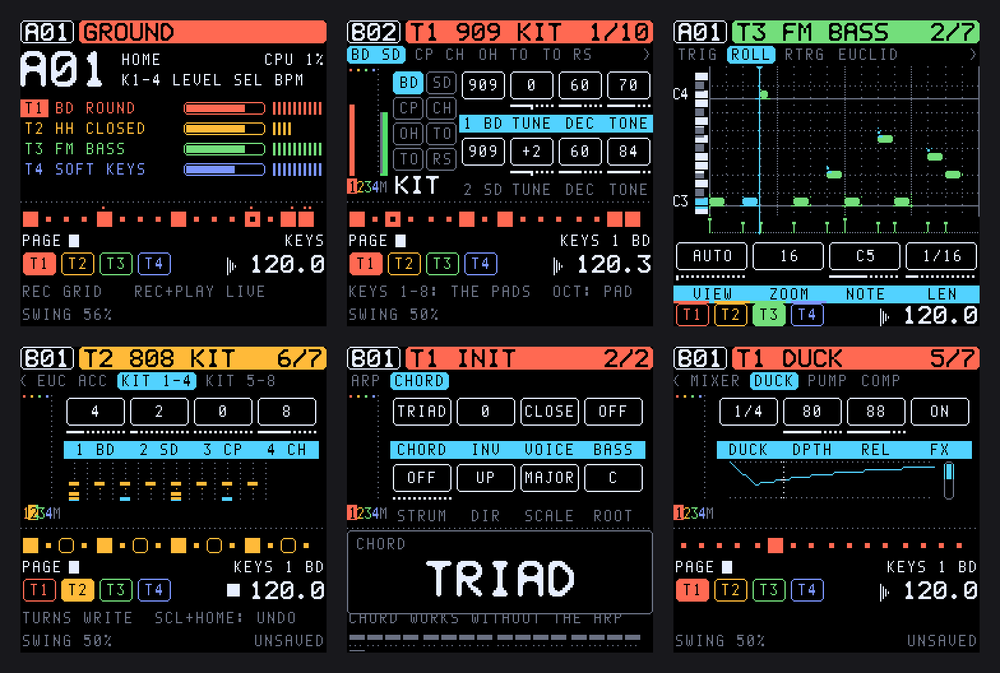

<h1 align="center">TONIC</h1>

<p align="center">
  <b>A Digitone-style FM groovebox firmware for the M-VAVE FM-1</b><br>
  Four-operator FM, virtual analog and a synthesized drum kit, with a 64-step sequencer, parameter locks and twelve
  voices, on the FM-1's own keys, knobs and screen.
</p>

<p align="center">
  <a href="https://rahelpuest.github.io/tonic-fm1/emu/"><b>▶ Try it in your browser</b></a> ·
  <a href="https://rahelpuest.github.io/tonic-fm1/install/">Install</a> ·
  <a href="https://rahelpuest.github.io/tonic-fm1/manual/">Manual</a> ·
  <a href="https://github.com/RahelPuest/tonic-fm1/releases">Releases</a>
</p>

<p align="center">
  
  
  
</p>

<p align="center"></p>

> [!NOTE]
> TONIC runs on the M-VAVE FM-1. Each release is also tested in software: engine tests, a host simulator, the browser
> emulator and an instruction-level FM-1 emulator that executes the real device binary. It is a custom firmware, so
> install it at your own risk; the installer can put M-VAVE's own firmware back, and [docs/INSTALL.md](docs/INSTALL.md)
> describes the recovery routes.

## What it is

TONIC replaces the FM-1's firmware with a four-track groovebox modelled on the original **Elektron Digitone** (2018).
Its parameters, curves and sequencer follow the Digitone closely, and it adds a good deal of its own. It runs entirely
on the FM-1: the 16 white keys are the trig keys, and the 240 × 240 screen shows every page. Projects are saved to the
FM-1's flash.

### Sound

- **Three engines, chosen per sound:**
  - **FM:** four operators, the Digitone's eight algorithms, HARM, operator envelopes, feedback.
  - **Virtual analog:** two oscillators with sync, cross-modulation, sub, noise, drift, a wavefolder and ring
    modulation.
  - **DRUM:** a kit of eight synthesized drums on one track, from 31 models (808/909 kicks, snares, hats, claps, toms,
    cymbals, FM hats …). Each pad has its own tune, decay, tone, level and pan, plus two controls named by its model
    (BEND / TICK, SNAP / BODY, NOIS / RESO …).
- **Twelve voices**, shared by the four tracks, with unison, reserved voices and four voice-stealing modes.
- **Per voice:**
  - overdrive, LO-FI (sample-rate and bit reduction), base-width and multimode filters (LP2, HP2, LP4);
  - an **insert effect** after the filter: overdrive, hard clip, fuzz, rectifier, wavefolder or bitcrusher;
  - **two LFOs** and a **modulation envelope**, each routable to 80+ destinations;
  - velocity, mod wheel, aftertouch, breath and pitch bend routings.
- **Effects:** chorus, delay (ping-pong) and reverb sends, a master compressor, a DJ filter, and sidechain ducking from a
  track, a single drum pad or the tempo itself (4/4 volume shaping).

### Sequencing

- **4 tracks × 64 steps**, each with its own length and speed (polymeters, 3/4×, 2×).
- **Parameter locks and sound locks** on every step, trig conditions (1:2, FILL, PRE, NEI …), micro timing, retrig and
  ratchets.
- **Live recording, step recording and grid recording**, a piano roll, undo, copy and paste.
- **Chords on every note**, with or without the arpeggiator: 22 named chords, inversions, voicings, bass and strum. Or
  give a sound a **scale**: every note snaps to it, and chords follow the scale's degrees (TRIAD, 7TH+, SUS4 …).
- An **arpeggiator** with six modes (TRUE, UP, DOWN, CYCLE, RANDOM, CHORD), 16 steps and their offsets.
- A **euclidean generator**: hits, rotation, accents, ghost notes, named rhythms (tresillo, son clave, bossa …),
  melodies, and every kit pad on one page.
- **Chains, song mode** (32 rows) and a **performance layer**: mutes, fills, tap tempo, loop rolls, tape stop, filter
  sweeps, freeze.
- **MIDI:** USB in and out, TRS in, MIDI clock, and MIDI tracks for external instruments.

## Try it without an FM-1

The **[browser emulator](https://rahelpuest.github.io/tonic-fm1/emu/)** runs the same code the FM-1 runs, with sound,
the whole panel on screen and Web MIDI. It is the quickest way to see whether TONIC is for you.

## Install

You need an M-VAVE FM-1, a USB data cable, and Chrome or Edge (or Python 3 for the command line).

1. **Back up first (recommended).** A full flash dump keeps your stock patches; see
   [docs/INSTALL.md](docs/INSTALL.md#0-before-the-first-install-a-full-backup-recommended).
2. **Install.** Use the [web installer](https://rahelpuest.github.io/tonic-fm1/install/) (connect the FM-1, press
   *Install*), or the command line:
   ```sh
   git clone --recursive https://github.com/RahelPuest/tonic-fm1.git && cd tonic-fm1
   pip3 install mido python-rtmidi
   python3 base/tools/fm1_install.py release/tonic-0.12.1.fwsc
   ```
3. **Going back** to the stock firmware: the web installer's *back to stock* button, or
   `python3 base/tools/fm1_install.py FM-1_015.fwsc` with M-VAVE's V15 package.

TONIC comes with 76 factory sounds; on its first start it writes a demo project (four patterns and a sound pool).

> [!NOTE]
> 0.12 saves in a new format. It reads every older project, but older versions cannot read what 0.12 has saved. If
> you may want to go back, take a USB backup first: `python3 base/tools/fm1_backup.py backup FILE`.

Every release since 0.1 stays in [`release/`](release/), with checksums in
[`release/SHA256SUMS`](release/SHA256SUMS).

## Documentation

| Document | |
| --- | --- |
| [Manual](tonic/docs/MANUAL.md) | every page, parameter and shortcut, with screens (also [on the site](https://rahelpuest.github.io/tonic-fm1/manual/)) |
| [User guide](docs/USER_GUIDE.md) | the short version: controls, pages, recording, saving, MIDI |
| [Install](docs/INSTALL.md) | installing, updating, backups, going back to the stock firmware, recovery |
| [Features](docs/FEATURES.md) | the Digitone's features one by one, and what TONIC adds |
| [Validation](docs/VALIDATION.md) | what was tested, how, and what remains uncertain |
| [Test environment](docs/TEST_ENVIRONMENT.md) | running TONIC without an FM-1 |
| [Building](docs/BUILDING.md) | building the firmware, the simulator and the emulator |
| [Design](docs/DESIGN.md) | how it is built: control map, engine, memory, storage |
| [Research](docs/RESEARCH.md) | what was learned from the Digitone and how |

## Building

```sh
git clone --recursive https://github.com/RahelPuest/tonic-fm1.git
cd tonic-fm1/tonic
python3 ../base/tools/build.py . --host     # the host simulator (no toolchain needed)
python3 ../base/tools/build.py . --web      # the browser emulator (Emscripten)
python3 ../base/tools/build.py .            # the firmware (JieLi toolchain: base/tools/get_toolchain.sh)
```

The details, the toolchain, the AC79 SDK files the package needs and the tests are in [docs/BUILDING.md](docs/BUILDING.md).

## Repository layout

| Path | |
| --- | --- |
| `tonic/` | the app: `engine/` (synthesis, effects, sequencer), `core/` (parameters, patterns, tables), `app/` (interface, storage, MIDI), `tests/`, `docs/` (the manual) |
| `base/` | [fm1-base](https://github.com/charlesvestal/fm1-base) (submodule; this repository uses [a fork](https://github.com/RahelPuest/fm1-base/tree/tonic-lowram) with one extra RAM section): platform layer, build tools, simulator, emulator, installer |
| `docs/` | the documents above |
| `release/` | every released firmware, `SHA256SUMS`, and `site/` (the installer, emulator and manual served on GitHub Pages) |

## Credits and licence

TONIC is **MPL-2.0** ([LICENSE](LICENSE), details in [LICENSING.md](LICENSING.md)). It is built on
[fm1-base](https://github.com/charlesvestal/fm1-base) by Charles Vestal and
[felucca-bsp](https://github.com/hugelton/felucca-bsp) by Leo Kuroshita (Hügelton Instruments), and was tested with
[fm1-emu](https://github.com/joakimeriksson/fm1-emu) by Joakim Eriksson.

TONIC is an independent work inspired by the Elektron Digitone. It is not affiliated with or endorsed by Elektron or
M-VAVE, and it contains no Elektron code or data. Digitone is a trademark of Elektron Music Machines; M-VAVE and FM-1
are trademarks of their owners.
