# TONIC

TONIC turns the M-VAVE FM-1 into a four-track FM groovebox modelled on the original Elektron Digitone (2018). It has four synth tracks sharing twelve voices (the Digitone has eight), a four-operator FM engine with the Digitone's eight algorithms, and two more engines to choose per sound: virtual analog (VA) and DRUM, a kit of eight synthesized drums on one track. The sequencer has parameter locks, sound locks, trig conditions, micro timing and retrig. There is an arpeggiator, a piano roll, chorus, delay and reverb, a DJ filter and sidechain ducking. This manual covers every page, parameter and key combination.

**Status.** TONIC has not yet run on a physical FM-1. It is built and tested in software: engine tests, a host simulator, the browser emulator and fm1-emu, an instruction-level emulator that runs the real firmware file. Install it at your own risk, and read section 2 first.

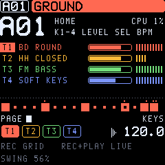

## Contents

1. Quick start
2. Installing and going back
3. The concepts
4. The panel
5. The screen
6. Playing the keys
7. Making a sound
8. SYN1 and SYN2: the FM, VA and DRUM engines
9. FLTR and AMP: filters, envelope, LO-FI
10. LFO1 and LFO2
11. Sequencing: grid recording
12. Live and step recording
13. The TRIG page
14. Trig conditions, micro timing, retrig
15. The piano roll
16. Pattern length, speed, chains and songs
17. The arpeggiator
18. Effects and the mixer
19. Ducking and the DJ filter
20. The performance layer
21. GLO: tempo, scale, voices, setup, modulation, MIDI
22. Saving and the SAVE page
23. MIDI
24. Shortcuts at a glance
25. Factory sounds and the demo
26. TONIC and the Digitone
27. Troubleshooting

---

## 1. Quick start

If you know the Digitone:

- The **16 white keys are the trig keys**. **REC** toggles grid recording, **REC+PLAY** starts live recording, and **SCL** is FUNC.
- The **page buttons** (SEQ, EDIT, ENV, LFO, FX, ARP, GLO) open the Digitone's parameter pages. K1–K4 turn one row of four parameters at a time.

A first ten minutes:

1. Switch on. The demo project loads with four patterns. Press **PLAY**.
2. Turn **ALGORITHM** to choose a track (T1–T4) and play the keys.
3. Turn **PRESETS** to browse the sounds and press **OCT+** to load one.
4. Press **ENV** and turn K1 (FREQ) to open and close the filter.
5. Press **REC**: the white keys now show the track's 16 steps. Tap a key to add or remove a trig.
6. Hold a lit step and turn a knob. That step alone gets the value, a *parameter lock*.
7. Hold **HOME**: the white keys pick patterns, black keys 1–4 mute tracks, and K1 sweeps the DJ filter.
8. Stop. TONIC saves by itself once the sound has died away.

## 2. Installing and going back

TONIC installs over USB with the FM-1's normal update path. You can use the **Install** page of this site (Chrome or Edge, from `localhost` or https) or the command line:

```sh
python3 base/tools/fm1_install.py --info
python3 base/tools/fm1_install.py tonic-0.12.fwsc
```

> Before the first install, take a full flash backup if you want to keep your stock patches. TONIC uses the same flash area for its project. Going back to stock brings the factory voices back, but not your old stock patches. The full procedure, with every check the installer makes, is in `docs/INSTALL.md`.

- **Updating TONIC:** install the new package the same way. Your project is kept, because an update writes only the app area. The earlier versions stay available on this site (`tonic-0.1.fwsc`: FM only; `tonic-0.2.fwsc`: the first VA engine; `tonic-0.3.fwsc`: 22 VA sounds; `tonic-0.3.1.fwsc`: the list window, loading as you turn; `tonic-0.3.2.fwsc`: the screen before 0.4; `tonic-0.4.fwsc`: the first colour screen; `tonic-0.4.1.fwsc`: before the DRUM engine; `tonic-0.5.fwsc`: the kit's ENGINE on K1; `tonic-0.5.1.fwsc`: the same sound as 0.5.2, a little more CPU and RAM; `tonic-0.5.2.fwsc`: before euclid, arp chords, the compressor, FOLD / RING and the four new drum models; `tonic-0.6.fwsc`: picking a kit's pad only through NOTE or by playing it; `tonic-0.6.1.fwsc`: before the momentary effects; `tonic-0.7.fwsc`: chords only with the arpeggiator, EUCLID with LEN, HITS and ROT alone; `tonic-0.8.fwsc`: 21 drum models, LFOs not reaching LO-FI or pads 5-8; `tonic-0.9.fwsc`: the labels and help before the UI audit) and go back on the same way.
- **Going back to an older TONIC:** 0.5 saves patterns and sound banks in a newer form, which older versions cannot read. Under 0.4.1 or earlier, a project saved by 0.5 shows empty patterns and an empty library. The data stays in the flash until the older version saves over it. Make a backup (below) before going back, and restore it after updating again. Going back from a newer version to 0.5.x or later is gentler: the older version reads the project and leaves out what it does not know (e.g. under 0.5.x the compressor, FOLD / RING and the chords; a pad with a new drum model plays BD 808). A library sound that uses something it does not know (a new drum model, the arp's RAND / CHRD, a chord voicing) shows as an empty slot there.
- **Back to the stock firmware:** install M-VAVE's `FM-1_015.fwsc` (V15) from TONIC. Then run System > Reset Patches on the stock firmware.
- **If something goes wrong:** two failed starts in a row bring up **SAFE MODE**, where USB is on and you can install again. Four bring up the chip's own update mode.
- **Backup of your project:** `python3 base/tools/fm1_backup.py backup FILE` and `restore FILE`. Stop the sequencer first.

## 3. The concepts

| Thing | What it is |
| --- | --- |
| **Project** | Everything: 32 patterns, a 16-sound pool, a 32-sound user library, the global settings. One project lives on the FM-1. |
| **Pattern** | A01–A16 and B01–B16. A pattern holds four tracks, their four sounds, the trigs and locks, tempo, swing, lengths, the effect settings and the mixer. |
| **Track** | T1–T4. Each plays one sound (or is a MIDI track for an external instrument). The tracks share 12 voices. |
| **Sound** | One patch, FM or VA (its ENGINE): the SYN1, SYN2, FLTR, AMP and LFO pages and the sound's setup (key scaling, play mode, portamento, modulation routing, arpeggiator). |
| **Trig** | A step with a note (a *note trig*), or with locks only (a *lock trig*). A note trig can hold a chord of up to 4 notes. |
| **Parameter lock** | A value that one trig plays instead of the track's. Almost every sound, trig and FX parameter can be locked. |
| **Sound lock** | A trig that plays a sound from the pool instead of the track's own. |
| **Pool** | 16 sounds kept with the project, for sound locks. |
| **Library** | 32 user sound slots, browsed with PRESETS after the factory sounds. |

The **twelve voices** are shared (eight before 0.11). A track takes a free voice for each note and steals the oldest when all are busy (GLO > VOICE sets how). You can also reserve voices for a track.

## 4. The panel

| Control | Function |
| --- | --- |
| **White keys (16)** | Keyboard mode: play the active track. Grid recording: steps 1–16 of the step page. HOME held: patterns. |
| **Black keys (11)** | Grid recording: step pages and step functions (section 11). HOME held: mutes, FILL, bank, tap tempo, temporary save, reload, restart (section 20). |
| **K1–K4** | The four parameters of the active row. With a step held: that step's locks. |
| **SELECT** knob | The next or previous row of the page. On HOME: tempo. On SAVE: the list. |
| **ALGORITHM** knob | The active track, T1–T4. |
| **PRESETS** knob | The track's sound: a list (factory sounds, then the user library; SCL: by group), OCT+ loads. On HOME: the pattern. With a step held: a sound lock. In step recording: the active step. On SAVE: the slot. |
| **MASTER** | The output volume. |
| **SEQ** | The TRIG page; pressed again: TRIG 2, the piano roll, RTRG, EUCLID, TRACK (length and speed). |
| **EDIT** | SYN1, SYN1 2, SYN2, SYN2 2: the FM engine (under VA: OSC, OSC 2, ENV, ENV 2; a kit: the pads, LEVEL, CTL, KIT). |
| **ENV** | FLTR, FLTR 2, AMP, AMP 2, LOFI, INSRT. |
| **LFO** | LFO1, LFO2, MENV. |
| **FX** | CHORUS, DELAY, REVERB, MIXER, DUCK, PUMP, COMP. |
| **ARP** | The arpeggiator; CHORD with the sound's SCALE. |
| **GLO** | Tempo, scale and length, voices, sound setup, portamento, modulation, song, keyboard, MIDI. |
| **HOME** | Tap: the home screen. Hold: the performance layer. Tap twice: lock it. |
| **SAVE** | The SAVE page. SCL+SAVE saves now. |
| **PLAY** | Start / stop. |
| **REC** | Grid recording on / off. |
| **OCT− / OCT+** | The keyboard's octave; with a step held, its note. |
| **SCL** | FUNC: the second function of the other controls. |

**Rows and pages.** A Digitone page has eight parameters; TONIC shows them as two rows of four, and K1–K4 turn the lit row. Press the page button again for the next row (it steps when you let go). SCL + page button goes back one row; SELECT also steps through the rows. The top right of the screen shows the row's number, for example 2/5.

**Knob speed.** A slow turn moves the finest step: a quarter step on the parameters the Digitone shows with two decimals. A fast turn moves further. Hold **SCL while turning** for the finest step at any speed.

## 5. The screen

TONIC draws the Digitone's screen layout at the LCD's full resolution and in colour.

- **Header:** the pattern, then a bar in the active track's colour with its sound and the row number.
- **Tabs:** under the header, the pages of the button you pressed (for example SYN1 · SYN1 2 · SYN2 · SYN2 2); the page shown is highlighted. GLO has too many for one line: < and > show that more are there.
- **Left column:** meters for T1–T4 in their colours and the master (M: green, yellow, red near full scale). The active track's number is highlighted.
- **Middle:** the page's two rows of four values. The row the knobs edit has its names on an accent bar; locked values are shown in the accent colour.
- **Moving pictures:**
  - A dot runs along the envelopes (operator A and B, filter, amp) where the track's sound is now.
  - A dot runs along the LFO wave at its phase.
  - The filter row shows the filter's curve. It follows the cutoff as the filter envelope moves it; the set cutoff is dotted.
  - On SYN1 the algorithm's lines grow thicker with the modulation (LEV × envelope).
- **Bottom band:** the 16 steps in the track's colour (the playhead moves along them), the step pages, the tracks in their colours and the tempo.
- **Mode line:** what the keys do now (KEYS, GRID, PERFORM …).
- **Colours:** GLO > DISPLAY > THEME: OLED (white on black), AMBER, PHOSPHOR (green), BLUE, PAPER (dark on light). The theme is kept with the project's settings.

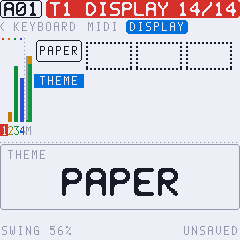

When you turn a knob, a **pop-up** shows the parameter's name and value large for a moment.

**Help:** hold a button on its own for a second (SCL, a page button, REC, PLAY, OCT, SAVE, FX, GLO, ARP), and the screen lists what it does alone and in combinations. Let go to return.

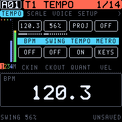
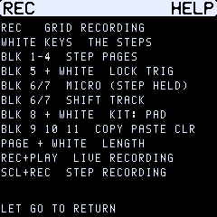

## 6. Playing the keys

- In **keyboard mode** (REC dark), the 27 keys play the active track chromatically from the keyboard's octave. OCT− and OCT+ move it. SCL + white key 1–4 picks the track.
- **Velocity and pressure:** the keys are velocity-sensitive. GLO > TEMPO > VEL picks KEYS (as played) or FIXED (GLO > SCALE > FIX VEL).
- **Keyboard scale and chords:** GLO > KEYBOARD maps the keys to a scale with a root. FOLD leaves out the notes outside the scale, and CHORD plays a chord per key (ON, MAJ, MIN, 7TH, MIN7, MAJ7, DIM, DIM7).
- **Transpose:** SCL+OCT transposes the track by a semitone. HOME held + OCT transposes the whole pattern.

Scales: CHROM, MAJOR, MINOR, DORIAN, PHRYG, LYDIAN, MIXO, LOCRIAN, PENT MA, PENT MI, HARM MI, WHOLE.

## 7. Making a sound

1. Choose the track with **ALGORITHM**. Turn **PRESETS** to start from a factory sound (a list opens: OCT+ loads the sound under the cursor; SCL + PRESETS jumps by group, e.g. to the VA sounds), or use SAVE > INIT SOUND for a plain sine.
2. **EDIT > SYN1:** the algorithm and the operators' ratios. Nothing modulates until LEV A or LEV B (SYN2) is up.
3. **EDIT > SYN2:** the two operator envelopes. They shape how the timbre moves.
4. **ENV:** the filters, the amp envelope, drive, pan, volume and the effect sends.
5. **LFO:** movement, as vibrato, wobble or filter sweeps.
6. To use the **VA engine** instead of FM, go to EDIT, the last row (SYN2 2), and set K4 **ENGINE** to VA. The SYN pages become the oscillator pages (section 8). **ENGINE DRUM** makes the track a drum kit, or load one of the KITS presets.
7. Keep it with **SAVE > SOUND > LIBRARY** (32 user slots, chosen with PRESETS) or **SOUND > POOL** (for sound locks).

Holding a page button gives two shortcuts:

- **CONTROL ALL:** hold SEQ, EDIT, ENV or LFO and turn a knob. The value goes to all four tracks. A parameter whose meaning is the engine's (the SYN pages, the LFO and modulation destinations) goes only to the tracks of the same engine.
- **Randomize:** hold the page button and press REC. The row's four sound parameters get random values.
- **Defaults:** hold the page button and press OCT−. The row goes back to its defaults.
- **Revert:** in all three cases, press SCL while still holding the page button to undo.

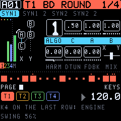

## 8. SYN1 and SYN2: the FM, VA and DRUM engines

TONIC's engine has four sine operators named as on the Digitone: **C** (carrier), **A**, **B1** and **B2**. The algorithm decides who modulates whom. Each algorithm has two outputs, **X** and **Y**, and MIX fades between them.

### SYN1, row 1

| Param | Range | What it does |
| --- | --- | --- |
| ALGO | 1–8 | How C, A, B1, B2 connect; the diagram shows it, with the feedback operator marked. |
| C | 0.25–16 (19 steps) | Ratio of operator C. |
| A | 0.25–16 (36 steps) | Ratio of operator A. |
| B | B1 / B2 | Ratios of B1 and B2 on one knob: B2 moves first, then B1 (like the hands of a clock). |

### SYN1, row 2

| Param | Range | What it does |
| --- | --- | --- |
| HARM | −26…+26 | Operator waveform. Negative values shape C, positive values shape A and B1. 0 is all sine. |
| DTUN | 0–127 | Detunes A and B2: slightly up to about 64, strongly above. |
| FDBK | 0–120 | Feedback of the algorithm's feedback operator. Low values brighten; high values give a saw, then noise. |
| MIX | −64…+63 | From output X (−64) through both (0) to output Y (+63). |

### SYN1 2: ratio offsets

OFSC, OFSA, OFB1, OFB2 (−0.999…+0.999) are added to each operator's ratio. Use them for inharmonic, bell-like and metallic tones.

### SYN2: operator envelopes

Envelope **A** drives operator A. Envelope **B** drives B1 and B2. On the screen the two rows are marked A and B, and their knobs read ATK, DEC, END, LEV.

| Param | Range | What it does |
| --- | --- | --- |
| ATK A / ATK B | 0–127 | Attack time. |
| DEC A / DEC B | 0–127 | Decay time to the END level. |
| END A / END B | 0–127 | The level the envelope settles at. |
| LEV A / LEV B | 0–127 | How strongly the operator modulates (the FM depth). LEV B is shared: B1 alone below 43, B2 takes over up to 85, both above. |

### SYN2 2

| Param | What it does |
| --- | --- |
| ADEL / BDEL | Envelope delay, in 1/32 beats. |
| ATRG / BTRG | ON: the envelope is trigged (attack, decay, end). OFF: gated, so it holds while the key is held. |
| ARST / BRST | ON: a new note restarts the envelope from zero. |
| PHRT | Phase reset at note-on: OFF, ALL, C, A+B, A+B2. A reset also clears the filter, for click-free and repeatable attacks. |

> FM in one sentence: the carrier C is what you hear, and A and B change its timbre by modulating it. Their ratios decide which partials appear (whole numbers: harmonic; offsets: inharmonic), LEV decides how bright, and the envelopes decide how the brightness moves.

### The VA engine

A sound's **ENGINE** (EDIT, SYN2 2, K4) is **FM** or **VA**. With VA, two oscillators, a sub-oscillator and noise replace the four operators. Everything after them is the same as for FM: overdrive, LO-FI, the filters, the amp, the LFOs and the effects.

Switching ENGINE sets the SYN pages to that engine's defaults. The FLTR, AMP and LFO settings stay, and undo takes a switch back. The pages are titled OSC, OSC 2, ENV and ENV 2, and the left column shows the two waves, the sub and the noise.

")
, envelope B with MENV (OSC2's pitch)")

| Page | Param | Range | What it does |
| --- | --- | --- | --- |
| OSC | WAV1, WAV2 | SAW, SQR, TRI, SIN, OFF | The two oscillators' waves (band-limited saw and square). |
| OSC | SUB | 0–127 | A square an octave below OSC1. |
| OSC | TUNE | ±24 semitones (quarter steps) | OSC2's pitch. |
| OSC | DETN | 0–127 | Pulls the two oscillators apart, up to 50 cents. |
| OSC | PW | 0–120 | Pulse width of SQR: 50 % at 0, narrow at 120. Lovely on an LFO (PWM). |
| OSC | MIX | −64…+63 | OSC1 (−64) to OSC2 (+63). |
| OSC 2 | SYNC | OFF / ON | Hard sync: OSC2 restarts with each cycle of OSC1. Sweep TUNE or MENV for the classic sync sound. |
| OSC 2 | NOIS | 0–127 | White noise. |
| OSC 2 | XMOD | 0–127 | OSC2 modulates OSC1's phase: metallic, FM-like edges. |
| OSC 2 | DRFT | 0–127 | Slow random wandering of the pitch per voice: analog warmth. |
| ENV | ATK, DEC, END A; PENV | 0–127 | Envelope A moves the pitch of both oscillators up by PENV (up to +48 semitones): kicks, zaps, blips. |
| ENV | ATK, DEC, END B; MENV | 0–127 | Envelope B moves OSC2's pitch up by MENV: sync sweeps. |
| ENV 2 | delays, trig mode, reset | | As in FM. RST ON starts the oscillators from zero on each note (punchy, repeatable attacks); OFF lets them run free. |

**SHAPE (TONIC 0.6):** FOLD and RING (0–63) on the last VA page.
- **FOLD** is a wavefolder. It drives the oscillators' mix up to nine times into a triangle that folds back at the top and bottom. A sine gains bright, buzzy overtones, the classic west-coast sound. An LFO or an envelope on FOLD makes the timbre move.
- **RING** adds ring modulation, OSC1 × OSC2. It brings in the sum and difference of the two pitches: bells, metal, robot voices. Detune OSC2 with TUNE for inharmonic tones.
- Both at 0 is the VA engine as before.

")

The LFOs and the modulation pages reach the VA parameters under their VA names (WAV1, SUB, TUNE 2, DETN, PW, MIX, PENV, MENV, PITCH 2, SYNC, NOIS, XMOD, DRFT, FOLD, RING). Unison (GLO > VOICE) with DETN and DRFT makes supersaw-style stacks.

> The FM and VA parameters share their places in the sound. A parameter lock on a SYN page therefore means the engine's own parameter: a lock of RAT A on an FM sound would be the unused slot on a VA sound. When a sound lock plays a sound of the other engine, the SYN locks of that step act on its parameters.

### The DRUM engine

With **ENGINE DRUM** a track becomes a **kit of eight pads**, each a synthesized drum (no samples): kicks, snares, hats, toms and percussion in the manner of the classic drum machines. One track holds a whole drum set, so the other three stay free for bass, chords and leads. Load a kit from the **KITS** presets (808, 909, FM, ELECTRO, TECHNO, LOFI, PERC, TRAP) or switch ENGINE (EDIT, SYN2 2, K4) to DRUM for the default kit.

**Playing.** The white keys are the pads: keys 1–8 are pads 1–8, keys 9–16 the same pads again (a black key plays the white key to its left). OCT does not move them. The notes behind the pads are C4, D4, E4, F4, G4, A4, B4 and C5, also over MIDI. Track transpose and the keyboard's scale and chord settings leave a kit alone.

**The pages.** The SYN pages become the kit:

| Page | Row | K1 | K2 | K3 | K4 |
| --- | --- | --- | --- | --- | --- |
| PAD 1-2 … PAD 7-8 (the tabs show the models, e.g. BD SD) | one row a pad | MODEL | TUNE | DEC | TONE |
| LEVEL | pads 1–4, pads 5–8 | level | level | level | level |
| KIT | | | | | ENGINE |

; the kit on the left, lit as its pads sound")
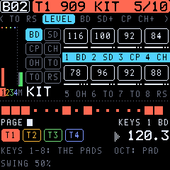

The knobs are named after their pad (1 BD, 2 SD …). Playing a pad on the keys moves the knobs to its row, so you hit a drum and turn it. The picture on the left shows the eight pads; a pad lights while it sounds, and the pad the grid places (below) is drawn in the foreground.

| Param | Range | What it does |
| --- | --- | --- |
| MODEL | 31 models | The pad's instrument (the box shows its flavour, the name above it the instrument). |
| TUNE | −64…+63 | Pitch in half semitones (±32 semitones); 0 is the model's own pitch. |
| DEC | 0–127 | Decay, from a ninth of the model's length (0) through its own (64) to nine times it (127). |
| TONE | 0–127 | The model's character, see below. |
| LEV | 0–127 | The pad's level in the kit. |

| Model | Sound | TONE |
| --- | --- | --- |
| BD 808 | Sine kick with a long boom | Punch: the pitch sweep at the start |
| BD 909 | Short, saturated kick | Click: the noise attack |
| BD FM | FM kick | Growl: the FM depth |
| SD 808 | Two tones and bright noise | Snappy: tone ↔ noise |
| SD 909 | One falling tone and noise | Snappy |
| RIM | Rimshot: two short pings | Balance of the two |
| CLAP | Three noise bursts and a tail | Brightness |
| HH CL, HH OP | Closed and open hats: six detuned squares (the 808's metal) and noise | Metal ↔ noise |
| CYMBAL | The metal, lower and long | Brightness |
| TOM, CONGA | Sine with a pitch drop | The drop's depth |
| COWBEL | Two squares through a bandpass | Brightness |
| CLAVE | A short wooden ping | Hardness |
| SHAKER | Noise with a soft attack | Brightness |
| ZAP | A sine falling fast through octaves | Sweep range |
| NOISE | Filtered noise | Under 64 lowpass, over 64 highpass |
| CLAP 2 | A tighter clap: four bursts, closer and brighter (909-like) | Brightness |
| TAMB | Tambourine: high jingles with a second shake | Brightness |
| MARACA | A very short, high maraca (808-like) | Brightness |
| LASER | A laser tom: a sine falling through a wide sweep, slightly driven | The sweep's range |
| BD SUB | A deep sub kick (about 41 Hz), long and warm | The pitch sweep |
| BD DIST | A distorted kick (hardstyle, gabber, industrial) | The distortion |
| BD PNCH | A short, punchy kick with a click | The click |
| SD FAT | A deep, full snare: two low tones, warm noise | Snappy |
| SD 606 | A light, bright snare, mostly noise | Snappy |
| SD BRSH | A brush: noise swept in, a soft band | Brightness |
| HH 9 CL, HH 9 OP | 909-like hats: the metal higher and noisier, brighter (the closed one chokes the open ones) | Metal ↔ noise |
| HH FM | A metallic FM hat: two inharmonic sines, the index falling | Hardness (the FM depth) |
| HH 606 | A bright noise hat, very short (chokes the open ones) | Brightness |

**The pads' controls (SYN > CTL 1-2 … CTL 7-8, TONIC 0.12).** Each pad has two more knobs whose meaning is its model's, and its own PAN. At 0 the model sounds exactly as before; the knob names follow the model:

| Models | CTL A | CTL B |
| --- | --- | --- |
| BD 808, BD 909, BD FM, BD SUB, BD DIST, BD PNCH, TOM, CONGA, ZAP, LASER | **BEND**: the pitch sweep's depth (× 1/4 … 4) | **TICK**: the click (− less, + a click where the model has none) |
| SD 808, SD 909, SD FAT, SD 606 | **SNAP**: the noise (snappy) | **BODY**: the tone |
| RIM / CLAVE | **HARD**: the drive | **TUN2** (rim): its second tone, ±1 octave |
| CLAP, CLAP 2 | **SPRD**: the bursts' spacing | **TAIL**: the reverb-like tail |
| HH CL, HH OP, HH 9 CL, HH 9 OP, CYMBAL, TAMB | **NOIS**: noise against metal | **RESO**: the band's resonance |
| COWBEL | **TUN2**: the two tones' interval | **RESO** |
| HH FM | **TUN2**: the modulator's ratio | **FM**: the index |
| SHAKER, MARACA, SD BRSH | **RISE**: the swell | **RESO** |
| NOISE, HH 606 | **RESO** | — |

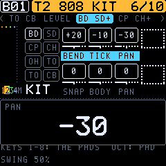

**PAN** (−64 left … +63 right) places the pad on its own, on top of the sound's PAN. All three can be locked per step.

**How a kit plays.**
- Each pad plays as a one-shot: it rings for its own decay, however long the note is.
- A pad hit again takes over its own voice, so a fast hat roll uses one voice, not eight.
- A closed hat (HH CL, HH 9 CL, HH 606) chokes an open one (HH OP, HH 9 OP) on the same track.
- The kit still shares the twelve voices with the other tracks. Long open hats or cymbals and pad chords can use up voices.
- Everything after the drums works as for FM and VA: overdrive, LO-FI, the filters with their envelope, the amp, the LFOs, the effect sends.
  - The AMP envelope starts open (ATK 0, SUS 127, REL INF). A shorter release gates the kit by the note length.
  - The filter and LO-FI act on the whole kit.
- Parameter locks work per pad. Lock 2 SD's TUNE on one step and only the snare there changes.
- Retrig (TRIG page) gives snare rolls and hat ratchets.
- Every pad is an LFO and modulation destination (1 TUNE … 8 LEV), and the whole kit too (ALL TUNE, ALL DEC, ALL TONE, ALL LEV). PITCH moves the whole kit.

**Picking the pad.** The **picked pad** is the one the grid places, EUCLID writes and NOTE shows. The screen shows it beside the mode at the bottom right (e.g. GRID 4 CH). Pick it in any of these ways:
- In grid recording: hold **black key 8** and press **white key 1–8**.
- Anywhere: **SCL + OCT−/OCT+**, the pad before or after it. A kit has no transpose.
- Playing the keys: **OCT−/OCT+** alone (a kit has no octaves), or simply play the pad.
- **NOTE** on the TRIG page, which shows the pads (1 BD, 2 SD …).

**Programming beats.** In grid recording (section 11) a step key places the picked pad. A step can hold up to four pads:
- A step key on a step without the picked pad adds that pad.
- A short tap on a step with the picked pad takes only that pad out.
- The step keys and the screen show the picked pad's steps lit and the other pads' steps half lit.

Live and step recording record the pads you play.

> A kit's pads 1–4 keep their settings in the SYN pages' FM places, pads 5–8 in their own. Switching ENGINE to or from DRUM sets the SYN pages and the amp envelope to the new engine's defaults (undo takes it back).

## 9. FLTR and AMP: filters, envelope, LO-FI

The signal path of a voice is: operators → overdrive → LO-FI → base-width filter → multimode filter → amp → pan → sends.

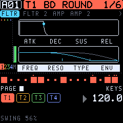

### FLTR

| Param | Range | What it does |
| --- | --- | --- |
| ATK, DEC, SUS, REL | 0–127 (REL 127 = INF) | The filter envelope. |
| FREQ | 0–127 | Cutoff, 5 Hz to past 20 kHz (exponential). |
| RESO | 0–127 | Resonance; LP4 can scream near the top. |
| TYPE | OFF, LP2, HP2, LP4 | Multimode filter type. |
| ENV | −64…+63 | How far the envelope moves the cutoff. |

### FLTR 2

| Param | Range | What it does |
| --- | --- | --- |
| DEL | 0–127 | Filter envelope delay. |
| BASE | 0–127 | Base-width filter: its highpass corner. |
| WIDTH | 0–127 | The band's width; its lowpass sits at BASE + WIDTH (127 = open). |
| KTRK | 0–100 | Keyboard tracking of the cutoff (100: one octave per octave). |

### AMP

| Param | Range | What it does |
| --- | --- | --- |
| ATK, DEC, SUS, REL | 0–127 (REL 127 = INF) | The amp envelope (times to −60 dB, as the Digitone's). |
| DRV | 0–127 | Overdrive before the filters. |
| PAN | L64…R63 | Pan. |
| VOL | 0–127 | The sound's volume. |
| AENR | ON / OFF | ON: the amp envelope resets on each note. |

### AMP 2: sends

CHR, DEL and REV (OFF to 127) send the voice to the chorus, delay and reverb.

### LOFI (TONIC's own)

| Param | Range | What it does |
| --- | --- | --- |
| SRR | OFF, 1–127 | Sample-rate reduction: each sample is held for up to 64 samples. It gives aliasing and grit, and it sweeps smoothly. |
| BRR | OFF, 1–127 | Bit reduction from 16 bits down to 2. |

LOFI comes after the overdrive and before the filters, so the filter can tame it. Both can be locked per step.

### INSRT: the insert effect (TONIC 0.12)

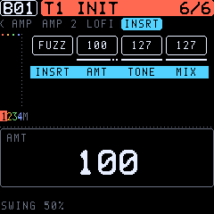

Each voice has an insert effect after the filter (the overdrive DRV comes before it). It needs no memory, so it costs nothing when it is OFF.

| Param | Range | What it does |
| --- | --- | --- |
| INSRT | OFF, OVER, HARD, FUZZ, RECT, FOLD, CRUSH | OVER: soft overdrive. HARD: hard clipping. FUZZ: an asymmetric, heavy fuzz. RECT: the wave rectified (an octave up, gritty). FOLD: a wavefolder (bright, metallic overtones). CRUSH: bits (12 down to 2) and the sample rate (held up to 16 samples), after the filter. |
| AMT | 0–127 | How hard it drives. |
| TONE | 0–127 | A lowpass on the effect, from 100 Hz up (127: open). |
| MIX | 0–127 | Dry against the effect (127: the effect only). |

AMT, TONE and MIX are also LFO and modulation destinations (**I AMT, I TONE, I MIX**).

## 10. LFO1 and LFO2

Each voice has two LFOs. LFO2 can also modulate LFO1.

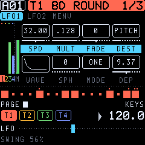

| Param | Range | What it does |
| --- | --- | --- |
| SPD | −64…+63 | Speed (negative: backwards). The rate is SPD × MULT. |
| MULT | 1…2K, .1….2K | Multiplier. Plain values are synced to the tempo; dotted values run at a fixed 120 BPM. |
| FADE | −64…+63 | Negative: fades in; positive: fades out. |
| DEST | list | What it moves (below). |
| WAVE | TRI, SIN, SQR, SAW, EXP, RMP, RND | Waveform. |
| SPH | 0–127 | Start phase. |
| MODE | FRE, TRG, HLD, ONE, HLF | Free running; restarted by each note; held at note-on; one cycle; half a cycle. |
| DEP | −64.00…+63.94 | Depth, in 1/16 steps near zero. DEP 1.00 on PITCH is ±2 semitones. |

### MENV: the modulation envelope (TONIC 0.12)

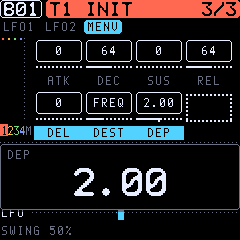

A third modulator: an envelope, started by every note, that goes to any destination as an LFO does (DEST: the same list).

| Param | Range | What it does |
| --- | --- | --- |
| ATK, DEC, SUS, REL | 0–127 | As the filter envelope: attack, decay, sustain, release (REL 127: infinite). |
| DEL | 0–127 | A delay before it starts. |
| DEST | list | What it moves (the LFOs' destinations; LFO1's parameters too, so it can fade in a vibrato). |
| DEP | −64.00…+63.94 | Depth: positive goes up, negative down. |

Ideas: a pitch blip at the start (DEST PITCH, short DEC), FM index that falls (HARM or A LEV), the insert's drive that swells (I AMT), the reverb send that opens with the release.

**Destinations:** ALGO, RAT C, RAT A, RAT B, HARM, DTUN, FDBK, MIX, A/B envelope parameters, PITCH, PIT AB2 (pitch of A and B2), RAT ALL, AB LEV, AB ATK/DEC/END/DEL, ratio offsets, FREQ, RESO, F ENV, filter envelope, BASE, WIDTH, amp envelope, DRIVE, PAN, VOL, REV, DEL, CHR. LFO2 also reaches LFO1's SPD, MULT, FADE, WAVE, SPH, MODE and DEP. From 0.9 also: **SRR** and **BRR** (LO-FI), and on a DRUM kit every pad (1 TUNE … 8 LEV) and the whole kit (**ALL TUNE, ALL DEC, ALL TONE, ALL LEV**). From 0.12 the insert effect: **I AMT, I TONE, I MIX**. LFO1's DEST skips LFO1's own parameters. The modulation pages (VELOCITY, MOD WHEEL, AFTERTOUCH, BREATH, PITCH BEND) reach every destination, LFO1's parameters too: the mod wheel on LFO1's DEP is the classic vibrato.

## 11. Sequencing: grid recording

Press **REC** (lit) for grid recording. The white keys are steps 1–16 of the step page; the screen and the keys show the trigs.

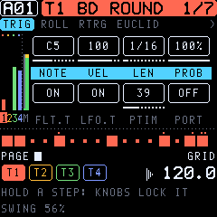

- **Add or remove:** press an empty step to place a note trig at the track's NOTE. Press a trig briefly to remove it. Hold it longer to edit it without removing it.
- **Parameter locks:** hold a step and turn K1–K4 on any page. Locked values show inverted. Hold several steps to lock them together.
- **Sound lock:** hold a step and turn PRESETS to pick a pool sound for it.
- **Lock trig:** SCL + white key (or black key 5 + white key) places a trig with locks and no note.
- **Note of a step:** hold it and press OCT−/OCT+ (SCL: by octaves), or turn NOTE on the TRIG page.
- **Chords:** record them live or in step recording; a trig holds up to 4 notes.
- **Drum kits:** a step key places the picked pad, and more pads join a step (section 8, The DRUM engine).

**The euclidean generator (SEQ, the EUCLID pages, TONIC's own).** It spreads a number of hits as evenly as possible over a cycle of steps: the rhythms of much of the world's music (3 in 8: the tresillo, 5 in 8: the cinquillo, 4 in 16: four to the floor).

| Page | Param | Range | What it does |
| --- | --- | --- | --- |
| EUCLID | LEN | 1–64 | The cycle, repeated over the track's length. |
| EUCLID | HITS | 0–LEN | The hits in it. |
| EUCLID | ROT | 0–LEN−1 | Turns the rhythm by steps. |
| EUCLID | STYLE | EUCL, TRESL (tresillo), CINQL (cinquillo), SON32, SON23 (son clave 3-2, 2-3), RUMBA, BOSSA, GAHU, FOUR, OFFBT (offbeat), BACKB (backbeat) | A named rhythm instead (ROT still turns it); turning LEN or HITS goes back to EUCL, with the LEN and HITS it had. |
| EUC ACC | ACC | 0–LEN | Accents: ACC of the hits, spread evenly over them, play loud; the other hits softer (0: all the same). |
| EUC ACC | AROT | 0–LEN−1 | Turns the accents. |
| EUC ACC | GHOST | 0–100 % | Ghost notes: the empty steps get soft notes, each with this chance. |
| EUC ACC | PROB | 1–100 % | The hits' own chance to play (as the TRIG page's PROB). |
| EUC NOTE | NOTES | FIXED, UP, UP DN, RAND, CHORD | (A melodic track.) FIXED: the track's NOTE (a hit on an existing trig keeps its note). The others walk the notes of the keyboard scale (GLO > KEYBOARD) up from NOTE: upwards, up and down, at random, or through the sound's CHORD (SCL3 if it has none). An instant bassline or melody. |
| EUC NOTE | RANGE | 1–3 | Octaves the notes span. |
| KIT 1-4, KIT 5-8 | 1 BD … 8 CB | 0–LEN | (A kit.) Each pad's HITS on one page: a whole beat in a few turns. The lanes below show the beat. |

- Each turn rewrites the track at once.
  - On a kit it writes only the **picked pad** (section 8), and the other pads stay. Give the kick 4 in 16, pick the hat and give it 6 in 16 with ROT 1, and so on. The KIT pages write each pad on its own knob.
  - On another track it places note trigs. It sets their velocity (ACC, GHOST) and their probability (PROB, GHOST: as trig conditions, so they change every pass); with FIXED, notes and locks of existing trigs stay.
- On a kit, the steps hold several pads, so accents and ghosts are the pad's LEV locked on its steps (an accent full, the other hits 70 %, a ghost 35 %). Its chances are rolled when it writes: turn a knob again for a new roll.
- With HITS at 0 and no STYLE, the other knobs wait; turning HITS writes.
- A step with locks keeps them: where a hit goes, it stays as a lock trig.
- A kit's step holds up to 4 pads; a fifth is not placed (**4 PADS FULL**). When the pattern has no room left, the turn is not written (**PATTERN FULL**).
- Undo (SCL + a tap on HOME) takes the last turns back, with the generator's settings.
- The circle shows the rhythm (accents ringed), the hits joined into their polygon, and the step playing now.
- The settings are remembered per track and per pad until the FM-1 is switched off.

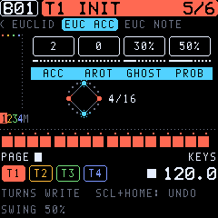
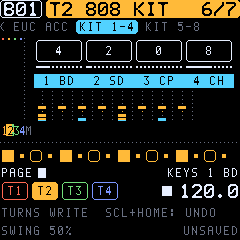

**Black keys in grid recording:**

| Key | Function |
| --- | --- |
| 1–4 | Step pages 1–4 (steps 1–16, 17–32, …). Hold one and press a white key to set the track's length. |
| 5 | LOCK: with a white key, a lock trig. |
| 6 / 7 | With steps held: their micro timing earlier / later. With none held: **shift the whole track** a step earlier / later, locks included. |
| 9 | COPY (the held steps, else the page; SCL: the track). |
| 10 | PASTE. |
| 11 | CLEAR (held steps: their locks; else the page; SCL: the whole track). |

**Undo:** SCL + a short tap on HOME takes back the latest edits. Everything within a moment counts as one step. The same again redoes them. It keeps one step, and starts afresh when you change patterns.

## 12. Live and step recording

**Live recording:** hold REC and press PLAY. Play the keys: the notes are written with their timing and length, and chords on one step become chords. Turning a knob records locks.

- PLAY (while holding REC) toggles quantize.
- PLAY alone leaves live recording; PLAY again stops.
- **Quantize afterwards:** GLO > SCALE (second row), K4 **MICRO** shows the track's largest micro timing. Turning it down shrinks every offset in proportion, and 0 puts all trigs on the grid.

**Step recording:** SCL+REC. The keys are a keyboard again. Play a note or a chord and it is written to the active step, which then moves on. PRESETS moves the active step, and knob turns lock it.

## 13. The TRIG page

SEQ opens the TRIG page: the track's defaults for new trigs, or a held step's own values.

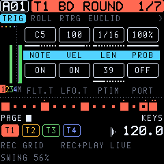

| Param | Range | What it does |
| --- | --- | --- |
| NOTE | C0–G10 | The note (Elektron's octave numbers: MIDI 60 is C5). |
| VEL | 1–127 | Velocity. |
| LEN | .125 … 128 steps, INF | Note length (1/16 is one step), in the Digitone's 128-value list. |
| PROB | 0–100 % | Probability. With a step held, this knob is **COND**, the trig condition (section 14). |
| FLT.T | ON / OFF | The trig restarts the filter envelope. |
| LFO.T | ON / OFF | The trig restarts the LFOs (in TRG, HLD, ONE and HLF modes). |
| PTIM | 0–127 | Portamento time. |
| PORT | ON / OFF | Portamento on for the track (locked per step: this trig glides). |

The track **LEVEL** is on the MIXER page and on HOME (K1–K4).

## 14. Trig conditions, micro timing, retrig

**Conditions:** hold a step and turn PROB/COND. The values come in the Digitone's order:

| Condition | The trig plays… |
| --- | --- |
| 1 % … 99 % | with that probability. |
| --- | always (no condition). |
| FILL / !FILL | only in fill mode / only outside it. |
| PRE / !PRE | if the track's last condition was true / false. |
| NEI / !NEI | if the track before (neighbour) was true / false. |
| 1ST / !1ST | on the first pass of the pattern / on the others. |
| A:B | on pass A of every B passes (1:2 … 8:8). |

**Micro timing:** hold a step and press black key 6 or 7. The trig moves in steps of 1/384 note, up to ±23 (almost a step).

**Retrig** (SEQ, fourth row **RTRG**, TONIC's own):

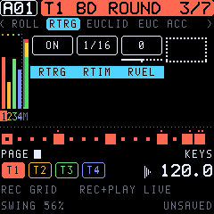

| Param | Range | What it does |
| --- | --- | --- |
| RTRG | OFF / ON | Note trigs repeat over their length (LEN). |
| RTIM | 1/1 … 1/80 | The rate: 1/1, 1/2, 1/3, 1/4, 1/5, 1/6, 1/8, 1/10, 1/12, 1/16, 1/20, 1/24, 1/32, 1/40, 1/48, 1/64, 1/80 (1/16 is one step). |
| RVEL | −128…+127 | Fade: negative fades the repeats out (to silence at −128); positive fades them in (from silence at +127). |

All three can be locked per step: one trig can roll while the next plays once. LEN sets how long the roll lasts, so a 1/16 trig at 1/64 gives four quick hits. The next note trig on the track ends a roll.

## 15. The piano roll

Press SEQ until the third row: the active track's notes as a piano roll.

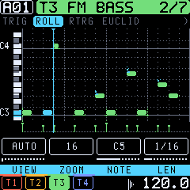

- **Keyboard and grid:**
  - A small keyboard runs along the left. The keys of the notes sounding now light up in the accent colour.
  - Black-key lanes are shaded, and each C has a line and its name.
  - Bars are solid lines, beats dotted.
- **Notes:**
  - Each note is a rounded bar in the track's colour, as long as it sounds. Chord notes stack, and micro timing shifts them.
  - Soft notes (velocity under 64) are hollow.
  - A note sounding now turns to the accent colour.
  - A retrig's repeats show as cuts in the bar.
  - A dot above a note marks locks or a condition.
- **Under the notes:**
  - The **velocity lane** shows each trig's velocity as a stalk.
  - Lock trigs are ticks there.
- **Playhead and length:** the playhead glides as a line with a marker on top. Steps past the track's length are shaded.
- **K1 VIEW:** AUTO fits the track's notes. Turn it to choose the lowest note shown.
- **K2 ZOOM:** 16 steps (the step page the keys reach), 32 or 64. The line on top marks the keys' page.
- **K3 NOTE, K4 LEN:** with a step held in grid recording, its note and length. The bar moves as you turn.
- **Drum kits:** the roll has a lane for each pad, named by its model (BD at the bottom), and each hit is a short block. A lane's mark at the left lights while its pad sounds, and the picked pad's name is in the accent colour.

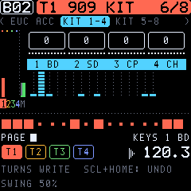

## 16. Pattern length, speed, chains and songs

**SEQ > TRACK** (and GLO > SCALE): length and speed are always the track's own (TONIC 0.12).

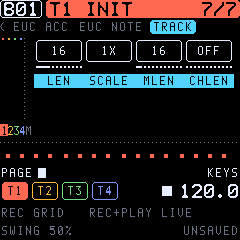

| Param | What it does |
| --- | --- |
| LEN | The track's length, 2–64 steps: give each track its own for polymeters. |
| SCALE | The track's speed: 1/8X, 1/4X, 1/2X, 3/4X, 1X, 3/2X, 2X (3/4X against 1X: triplet feels, 2X: double time). |
| TRNSP | The track's transposition, ±36 semitones. |
| MLEN | Master length: every track restarts after it (INF: never). |
| CHLEN | Change length: when a cued pattern takes over (OFF: at the master length; with MLEN INF too, at track 1's end). |

Patterns from before 0.12 with one length for all tracks (the former MODE PTRN) play as they did; the first LEN or SCALE turned on one track makes them per track, with MLEN INF and CHLEN OFF, so they keep changing at track 1's end.
| FIXVL | The velocity of the keys when VEL is FIXED. |
| MICRO | Quantize after recording (section 12). |

**Changing patterns:** turn PRESETS on HOME, or hold HOME and press a white key. The new pattern starts when the current one ends (or at its change length).

**Chains:** hold HOME and press several pattern keys in turn. They play one after the other and loop.

**Song mode** (GLO > SONG): up to 32 rows, each with a pattern, a repeat count and the tracks muted in it.

- Row 1: ROW picks the row to edit (a higher row lengthens the song), PTN its pattern, REPEAT how often it plays, MUTE which tracks are silent.
- Row 2: SONG switches song mode on, ROWS sets the song's length, and END loops or stops at the end.
- With song mode on, PLAY starts the song from its first row.

**Tempo and swing:** GLO > TEMPO, or turn SELECT on HOME. Swing runs from 50 to 80 %. TEMPO sets whether the tempo is the project's or each pattern's own. Tap tempo is HOME held + black key 8.

## 17. The arpeggiator

ARP turns held notes, from the keys or from trigs, into a pattern. It belongs to the sound.

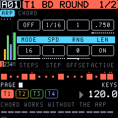

| Param | Range | What it does |
| --- | --- | --- |
| MODE | OFF, TRUE, UP, DOWN, CYCL, RAND, CHRD | TRUE plays in the order pressed; UP and DOWN by pitch; CYCL up and down; RAND at random; CHRD all the notes at once (TONIC's, with the chords below). |
| SPD | 1/1 … 1/96 | Note rate. |
| RNG | 1–4 | Octaves. |
| LEN | note length | Length of each arp note. |
| STEPS | 1–16 | The arp's step count. |
| STEP | 1–16 | The step to edit. |
| OFFSET | ±24 | That step's transposition. |
| ACTIVE | ON / OFF | Whether that step plays. |

**Chords (ARP group, the CHORD page; TONIC's own).** With a CHORD set, every note the sound plays becomes a chord: a key you hold, a trig of the sequencer, a retrig's repeats and a note from MIDI. **This works with the arpeggiator off**, and the chord then sounds as a whole. With the arpeggiator on, it walks through all the chord's notes instead: hold one key for a chord arpeggio, hold two and both chords are woven together. The chord belongs to the sound, so it is saved with it. A kit's notes are its pads and never become chords.

| Param | Range | What it does |
| --- | --- | --- |
| CHORD | OFF, MAJ, MIN, SUS2, SUS4, 7TH, MAJ7, MIN7, DIM, AUG, POWER, OCT, SCL3, SCL4, 6TH, MIN6, ADD9, MAJ9, MIN9, 7SUS4, 9TH, QUART (quartal), CLUST (cluster) | The chord on each note. **SCL3 / SCL4** build it from the track's keyboard scale (GLO > KEYBOARD, SCALE and ROOT): the three or four notes a third apart in that scale, so every key gives the chord that fits the key (in C major: C → C E G, D → D F A, B → B D F). With the scale CHROM they use C major's pattern from ROOT. QUART stacks fourths (modern, open); CLUST is three neighbouring semitones. |
| INV | 0–3 | Inversion: the lowest 1, 2 or 3 notes of the chord move an octave up. |
| VOICE | CLOSE, OPEN, DROP2, WIDE | CLOSE: as stacked. OPEN: the second note an octave up (wider, a "piano" spread). DROP2: the second highest note an octave down (the jazz pianist's voicing). WIDE: every other note an octave up, over two octaves (pads, strings). |
| BASS | OFF / ON | The root an octave below as well. |
| STRUM | OFF, 1–102 ms | The notes start one after another, up to 102 ms apart, as strummed on a guitar or a harp. |
| DIR | UP, DOWN, ALT | Strum low to high, high to low, or the other way each time (as a guitarist strums up and down). |

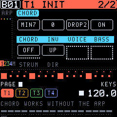

**The sound's scale (CHORD page, row 2: SCALE, ROOT; TONIC 0.12).** With a SCALE (MAJOR, MINOR, DORIA, PHRYG, LYDIA, MIXO, LOCRI, PENTA, PENTm, HARMm, WHOLE) and its ROOT, every note the sound plays snaps to the scale: keys, trigs, MIDI, the arpeggiator and its offsets (the nearest scale note, the lower one on a tie). A kit is never affected.

With a scale, **CHORD lists the chords by the scale's degrees** instead of their names, so each note gets the chord that belongs to the key:

| CHORD | Notes (degrees above the note) |
| --- | --- |
| 2ND, 3RD, 4TH, 5TH, 6TH, 7TH | The note and that interval in the scale (two voices) |
| OCT | The note and its octave |
| TRIAD | 1 3 5: in C major C → C E G, D → D F A, B → B D F |
| SUS2, SUS4 | 1 2 5, 1 4 5 |
| 6TH+, 7TH+, 9TH+ | 1 3 5 6, 1 3 5 7, 1 3 5 7 9 |
| ADD9 | 1 3 5 9 |
| QUART | 1 4 7 (stacked fourths) |
| POWER | 1 5 and the octave |

INV, VOICE, BASS and STRUM work on them as on the named chords. The named chord stays set: SCALE OFF brings it back.

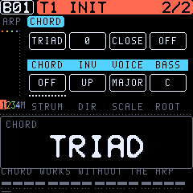

A chord of up to six notes uses that many voices, out of the twelve. A note let go ends the whole chord. GLO > KEYBOARD's own CHORD is something else: it makes the keys play several notes, and those notes are recorded into the trigs; the sound's CHORD plays a chord on whatever note comes in.

RNG, the step offsets and the modes work on the whole set of chord notes; MODE UP with RNG 2 plays the chord, then the chord an octave higher. Two modes are made for chords (0.8): **RAND** picks among the notes at random; **CHRD** plays the whole chord on every arp step (rhythmic chord stabs, strummed if STRUM is set), RNG moving it up an octave each step.

## 18. Effects and the mixer

The effects are per pattern and can be locked per step from any track; a lock holds until the track's next trig. The sends are on each sound's AMP 2 row.

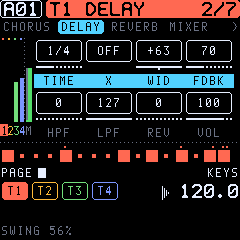

**CHORUS:**

| Param | What it does |
| --- | --- |
| DPTH | Depth. |
| SPD | Speed. |
| HPF | Input highpass. |
| WDTH | Stereo width. |
| DEL | Send to the delay. |
| REV | Send to the reverb. |
| VOL | Return level. |

**DELAY:**

| Param | What it does |
| --- | --- |
| TIME | 1/128 note to a bar, in 128ths with the usual values named (1/16, 1/8., 1/4T …); up to about 1.7 s. |
| X | Ping-pong. |
| WID | Stereo width or pan of the repeats. |
| FDBK | Feedback, 0–198. Above 127 it swells, but a soft limit keeps it bounded. |
| HPF, LPF | Filters in the feedback path. |
| REV | Send to the reverb. |
| VOL | Return level. |

Time changes glide like a tape delay.

**REVERB:**

| Param | What it does |
| --- | --- |
| PRE | Pre-delay. |
| DEC | Decay (127: INF, freeze). |
| FREQ | Shelving corner for damping in the tail. |
| GAIN | Shelving amount: 127 keeps the treble. |
| HPF, LPF | Input filters. |
| VOL | Return level. |

**MIXER:**

| Param | What it does |
| --- | --- |
| TRK1–TRK4 | Track levels. |
| MOVD | Master overdrive. |
| PVOL | Pattern volume (unity at 100). |
| FILT | The DJ filter (section 19). |

**COMP (TONIC's own):** a compressor on the master, after the effects. It glues a mix together and makes it denser.

| Param | Range | What it does |
| --- | --- | --- |
| AMT | OFF, 1–127 | Amount: threshold (0 to −30 dB) and ratio (1:1 to 6:1) together. Make-up gain follows automatically. OFF: the compressor is out of the signal. |
| ATK | 0.5–32 ms | Attack. Slow attacks let the drums' transients through. |
| REL | 20 ms–1.3 s | Release. |
| MIX | 0–127 | The compressed signal against the dry one (parallel compression); 127 is fully compressed. |

The line under the knobs shows the gain reduction (GR) as it happens. Like every effect, COMP can be locked per step.

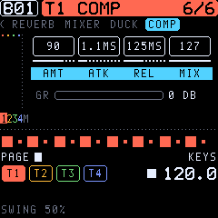

## 19. Ducking and the DJ filter

These are TONIC's own, not on the 2018 Digitone.

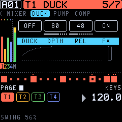

**Ducking (FX > DUCK, PUMP):** a source track's notes push the other tracks down, the classic sidechain pump. Or the tempo does it: volume shaping on every quarter (or eighth, …), with no kick needed.

| Page | Param | Range | What it does |
| --- | --- | --- | --- |
| DUCK | DUCK | OFF, T1–T4, 1/4, 1/8, 1/16, 1/2, 1/1 | The source: a track (its own level stays), or a division of the tempo, from PLAY (and running while stopped). |
| DUCK | DPTH | 0–127 | How far the others go down (127: to silence). |
| DUCK | REL | 0–127 | How fast they come back: 10 ms to 1.3 s. |
| DUCK | FX | ON / OFF | ON ducks the chorus, delay and reverb returns too. |
| PUMP | PAD | ALL, 1–8 | (A kit as the source.) Only this pad ducks, shown with its model (1 BD): the kick pumps, the hats do not. |
| PUMP | ATK | 0–127 | The dip comes in over 2–250 ms instead of at once: a softer, rounder pump. |
| PUMP | KEEP | OFF, T1–T4 | A track that is never ducked (with a division as the source: the kick's own track). |

")

Both pages draw the curve the settings make, one division long (a quarter with a track as the source), with a dotted line at the place in it now and a bar at the right for how far the mix is down now. **Four on the floor:** DUCK 1/4, DPTH 80–110, REL 60–90, KEEP the kick's track.

Every value can be locked per step. A trick: make the source a **MIDI track** (GLO > MIDI > EXT) with kick trigs and no instrument behind it. It ducks the pads without making a sound of its own.

**DJ filter (FX > MIXER > FILT):** one knob on the whole mix, after the master overdrive. Below 0 it is a lowpass (down to 78 Hz at −64); above 0, a highpass (up to 7.7 kHz at +63); 0 is off. It glides, so sweeps are smooth. On the performance layer it is K1.

## 20. The performance layer

**Hold HOME**, or **tap HOME twice** to lock it: then the layer stays without holding HOME (the header shows LOCKED), and a single tap on HOME leaves it. Locked, each pattern key picks its pattern; hold HOME while pressing several for a chain. The screen shows the performance page.

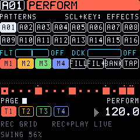

| Control | Function |
| --- | --- |
| White keys | Patterns 1–16 of the bank (changes at the pattern's end). Several in turn: a chain. |
| Black 1–4 | Mute T1–T4. |
| Black 5 | FILL while held. |
| Black 6 | FILL for the next pass. |
| Black 7 | The other bank (A / B). |
| Black 8 | Tap tempo: two taps set the tempo; up to four are averaged. |
| Black 9 | Temporary save of the pattern. |
| Black 10 | Reload (back to the temporary save, or to the saved pattern). |
| Black 11 | Restart the pattern. |
| K1 | The DJ filter. |
| K2 | Ducking depth (with DUCK set to a track). |
| OCT− / OCT+ | Transpose the pattern. |

On **HOME** itself (tapped), K1–K4 are the track levels and SELECT is the tempo.

### Momentary effects (TONIC 0.7)

On the performance layer, **hold SCL and press a white key 1–9**: its effect lasts as long as you hold the white key. You can let go of SCL (and even HOME) first; the key's release ends the effect. Several effects can be held at once, for instance a ROLL with a filter sweep. While SCL is held, the screen and the keys show the effects instead of the patterns; the effects held now are lit.

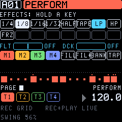

| Key | Effect | What it does |
| --- | --- | --- |
| 1–4 | ROLL 1/4, 1/8, 1/16, 1/32 | The sequencer repeats the stretch it is in (a quarter … a 32nd note), a loop roll. When you let go, the pattern goes on exactly in time, as if it had played through. The shortest roll held wins: hold 1/8, then add 1/32 for a tighter roll. |
| 5 | HALFTIME | The sequencer at half speed (the sounds keep their pitch). After it the pattern goes on from where it got to. |
| 6 | TAPE STOP | The whole machine runs down like a tape or a turntable: tempo and the pitch of every sound fall to a stop in 0.8 s. Let go: it spins back up in 0.2 s. |
| 7 | LP SWEEP | The DJ filter closes (lowpass) over 1.5 s; let go and it jumps back. |
| 8 | HP SWEEP | The same as a highpass: the bass goes, then all but the top. |
| 9 | FREEZE | The reverb holds its tail for ever and takes nothing new in: hit a chord, freeze, play on top of the frozen cloud. |

The effects act on the sequencer and the master; MIDI notes going out follow the sequencer (ROLL and HALFTIME change them too; MIDI clock out slows with HALFTIME and TAPE). Nothing is saved: the pattern is as it was.

## 21. GLO: tempo, scale, voices, setup, modulation, MIDI

| Page | Parameters |
| --- | --- |
| **TEMPO** | BPM (30–300), SWING (50–80 %), TEMPO (PROJ: one tempo for the project / PTRN: each pattern its own), METRO (metronome on / off); CKIN, CKOUT (MIDI clock in / out), QUANT (live recording quantized), VEL (FIXED / KEYS). |
| **SCALE** | See section 16. |
| **VOICE** | STEAL (CYCLE, TRACK, LO, HI: which voice goes when all are busy), REUSE (a repeated note takes its own voice again), VOICE (voices reserved for the track, up to 12; DYN shares), UNISN (unison: 1–4 voices a note), SPRD (unison detune and width), LAYER (the track's notes also play other tracks' sounds). |
| **SETUP** | KS A, KS B1, KS B2 (key scaling: less modulation up the keyboard), OCT (the sound's octave, ±2), PLAY (POLY, POLY M (one LFO for all voices), MONO, LEGATO), PRIO (LAST, LOW, HIGH), V>VOL (velocity to volume: OFF, LOG, LIN, EXP), PBDEP (pitch bend range, 0–24 semitones). |
| **PORTA** | TYPE (TRACK, VOICE, LEGATO), SLOPE (RATE or constant TIME), AMT, STYLE (GLIDE, GLISS: in semitones), GATE. |
| **VEL MOD, MODWHEEL, AFTERTCH, BREATH, PITCHBND** | Four destinations each, with a depth of ±128. Velocity, mod wheel, aftertouch, breath and pitch bend (from MIDI) move any listed parameter. |
| **SONG** | See section 16. |
| **KEYBOARD** | SCALE (CHROM, MAJOR, MINOR, DORIA, PHRYG, LYDIA, MIXO, LOCRI, PENT+, PENT−, HMIN, WHOLE), ROOT, FOLD, KCHRD (the keys play chords, recorded as notes; section 6; not the sound's CHORD, section 17). |
| **DISPLAY** | THEME: OLED, AMBER, PHOSPHOR, BLUE, PAPER. |
| **MIDI** | CH T1–CH T4 (each track's out channel), AUTO (the auto channel: it plays the active track), TRKCH (channels 1–4 play tracks 1–4), EXT (the active track plays only over MIDI, an external track). |

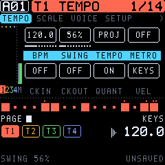

## 22. Saving and the SAVE page

TONIC saves by itself: changes are written to the flash **once the sequencer has stopped and the sound has died away**. A flash write stops the CPU for a moment, so nothing is written while it plays. SAVE glows while something is unsaved; **SCL+SAVE** writes at once. When you switch on, the last pattern is back.

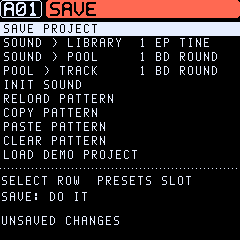

On the SAVE page, SELECT picks a row, PRESETS a slot, and SAVE does it. The destructive rows ask for a second SAVE; OCT cancels.

| Row | What it does |
| --- | --- |
| SAVE PROJECT | Writes everything now. |
| SOUND > LIBRARY | The track's sound into a library slot (1–32). |
| SOUND > POOL | The track's sound into a pool slot (1–16), for sound locks. |
| POOL > TRACK | A pool sound onto the track. |
| INIT SOUND | The plain init sound. |
| RELOAD PATTERN | Back to the pattern as saved. |
| COPY / PASTE / CLEAR PATTERN | Patterns as a whole. COPY keeps its pattern until the next COPY (TEMP SAVE has its own place). |
| LOAD DEMO PROJECT | The demo's four patterns and its pool (asks first). The other patterns are emptied; the sound library stays. |

While a pattern change is waiting (the next pattern cued), RELOAD, PASTE and CLEAR wait too (**PATTERN CHANGE / WAIT FOR IT**).

A pattern has a fixed room in the flash. A lock, an edit of a sound or a loaded sound that would not fit is refused with **PATTERN FULL**. A pattern that grew too big in another way (a long recording) keeps its notes when it is saved and drops its last locks (**PATTERN FULL / LOCKS DROPPED**).

## 23. MIDI

- **USB MIDI in and out.** The FM-1's TRS jack is MIDI in only; there is no DIN out.
- **In:**
  - Notes on channels 1–4 play tracks 1–4 (with TRK CH on); the AUTO channel plays the active track.
  - CC numbers follow the Digitone's for the sound parameters (CC MSB): for example 90 ALGO, 23 FREQ, 24 RESO, 7 VOL, 74 filter TYPE, 29 LFO1 DEP.
  - 94 mutes a track, 95 sets its level, and program change picks a pattern.
  - Mod wheel, breath, aftertouch and pitch bend go to the modulation pages.
- **Out:** each track's notes on its channel (GLO > MIDI), and MIDI clock when CLK OUT is on.
- **MIDI tracks:** GLO > MIDI > EXT makes the active track play an external instrument over USB-MIDI. Its trigs, chords, NOTE, VEL and LEN locks, conditions, micro timing, retrigs and arpeggios all go out, and no internal voice plays.
- **Clock in:** with CLK IN on, TONIC follows the incoming tempo, start and stop.

## 24. Shortcuts at a glance

| Combination | Does |
| --- | --- |
| SCL + HOME (tap) | Undo / redo. |
| SCL + SAVE | Save now. |
| SCL + PLAY | Stop and cut the effects' tails. |
| SCL + REC | Step recording. |
| REC + PLAY | Live recording (PLAY again: quantize on/off). |
| SCL + OCT | Transpose the track (a kit: the pad before / after). |
| Black 8 + white 1–8 (grid, a kit) | Pick the pad. |
| OCT (playing the keys, a kit) | The pad before / after. |
| SCL + PRESETS | The next / previous group of sounds (e.g. straight to the VA sounds). |
| SCL + knob | Finest steps. |
| SCL + page button | The row before. |
| SCL + white key (grid) | Lock trig. |
| SCL + white 1–4 (keyboard) | Pick the track. |
| Page button held + knob | CONTROL ALL (all four tracks). |
| Page button held + REC | Randomize the row. |
| Page button held + OCT− | Row back to defaults. |
| Page button held + SCL | Undo either of the three. |
| Step held + knob | Parameter lock. |
| Step held + PRESETS | Sound lock. |
| Step held + OCT | Its note. |
| Step held + black 6/7 | Micro timing. |
| Black 6/7, no step held (grid) | Shift the track. |
| Black 1–4 + white key (grid) | Track length. |
| HOME held | The performance layer (section 20). |
| HOME tapped twice | The performance layer locked (a tap on HOME: unlock). |
| PRESETS, then OCT+ / OCT− | Load the sound under the list's cursor / close the list. |
| HOME held + OCT | Transpose the pattern. |
| HOME held + SCL + white 1–9 (held) | A momentary effect: ROLL 1/4 … 1/32, HALFTIME, TAPE STOP, LP / HP SWEEP, FREEZE. |
| A button held alone (1 s) | Its help (not HOME: that is the performance layer). |

## 25. Factory sounds and the demo

TONIC's factory sounds are its own (not Elektron's). PRESETS steps through them, then the user library. Turning PRESETS opens a **list window** at the track's own sound (marked >). Each detent moves the cursor one sound; nothing changes yet. **OCT+ loads** the sound under the cursor, **OCT− closes** the list without loading. **SCL + PRESETS** jumps the cursor to the next or previous group (KEYS, BELLS, BASS, LEADS, PADS, DRUMS, TEXTURES, VA, KITS, INIT, then the user library as U01…). The groups are marked, and the cursor's group and place are on top. The list also closes after 6 s untouched, or when you press another button.

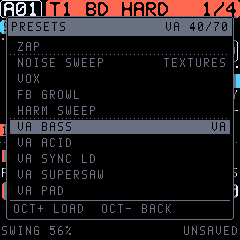 A sound sounding while you change it follows at once, its engine too.

| Group | Sounds |
| --- | --- |
| Keys | EP TINE, SOFT KEYS, CLAV, ORGAN 8, MARIMBA |
| Bells and mallets | DX BELL, BELL HIT, GLASS ARP, METAL HIT, COWBELL |
| Basses | FM BASS, SUB BASS, ACID, WOBBLE, REESE |
| Leads | SAW LEAD, SQUARE LEAD, BRASS |
| Pads | WARM PAD, STRINGS, GLASS PAD, DRONE, CHORD STAB, STAB |
| Drums and percussion | BD ROUND, BD HARD, SD FM, SD ROLL, HH CLOSED, HH OPEN, CLAP NOISE, TOM LOW, RIM, PERC BLIP, ZAP |
| Textures | NOISE SWEEP, VOX, FB GROWL, HARM SWEEP |
| VA engine | VA BASS, VA ACID, VA SYNC LD, VA SUPERSAW, VA PAD, VA BRASS, VA PLUCK, VA ZAP, VA KICK, VA HAT, VA FAT BASS, VA SQR BASS, VA WOBBLE, VA STRINGS, VA PWM PAD, VA SQR LEAD, VA STAB, VA CHIP ARP, VA SNARE, VA TOM, VA BELL, VA HOOVER, VA FOLD BAS (wavefolder), VA RING BEL (ring modulation), VA CHORD AR (a chord arpeggio) |
| DRUM kits | 808 KIT, 909 KIT, FM KIT, ELECTRO KIT, TECHNO KIT, LOFI KIT, PERC KIT, TRAP KIT, MODERN KIT, HARD KIT, DEEP KIT |
| Start | INIT |

**The demo project** (SAVE > LOAD DEMO PROJECT) has four patterns, A01–A04, and a sound pool. Take them apart: hold a step to see its locks.

## 26. TONIC and the Digitone

TONIC follows the Digitone (OS 1.44) closely. Its operator, filter, envelope, LFO, velocity and mixer curves are taken from measurements of the Digitone OS. Where the FM-1 differs:

- **4 tracks in all,** each a synth or a MIDI track, instead of 4 synth + 4 MIDI tracks.
- **32 patterns, a 16-sound pool and a 32-sound library** instead of 128 / 128.
- **4 knobs instead of 8:** each Digitone page is two rows.
- **One song** of up to 32 rows.
- **No audio input** and no DIN MIDI out. USB audio out carries the master.
- **The effects' algorithms are TONIC's own.** The parameters are the Digitone's.
- **TONIC's additions:** the VA and DRUM engines, the momentary effects, the euclidean generator, chords in the arpeggiator, the master compressor, retrig, LO-FI, the DJ filter, ducking, the piano roll, undo/redo, the help, tap tempo, track shift, row defaults and the value pop-up.
- **No compatibility:** TONIC does not read Digitone projects, sounds or SysEx.

The full comparison is in `docs/FEATURES.md`; the research behind the curves is in `docs/RESEARCH.md`.

## 27. Troubleshooting

| Problem | Try |
| --- | --- |
| No sound | MASTER up? Track muted (HOME held, black 1–4)? Track level (HOME, K1–K4)? Is the track a MIDI track (GLO > MIDI > EXT)? |
| Garbled sound names in the library | Banks saved by older builds are read in their own layout; a slot that does not read as a sound shows as empty and is skipped. |
| A sound is a plain sine | LEV A and LEV B (SYN2) are 0. FM needs them up. |
| A kit's drums are cut short | The AMP envelope's REL is low: it gates the kit by the note length. REL INF (127) lets each pad ring. |
| The grid places the wrong drum | The grid places the picked pad, shown at the bottom right (GRID 4 CH). Pick another: black 8 + white key 1–8 in the grid, or SCL + OCT. |
| Notes cut off | All 12 voices are busy: shorter releases, fewer chord notes, or reserve voices (GLO > VOICE). |
| Nothing is saved | Saving waits for the sequencer to stop and the sound to fade. Use SCL+SAVE to save at once. |
| The pattern doesn't change | Changes happen at the pattern's end (or CHLEN). Check MLEN and CHLEN in GLO > SCALE. |
| A trig doesn't play | A condition or PROB (hold the step and look at COND), a mute, or the track's length. |
| The FM-1 won't start TONIC | SAFE MODE comes up after two failed starts; install again from there (section 2). |
| Back to stock | Section 2 and `docs/INSTALL.md`. |

Try TONIC without an FM-1 in the **Emulator** on this site. It runs the same code, with sound and Web MIDI.
